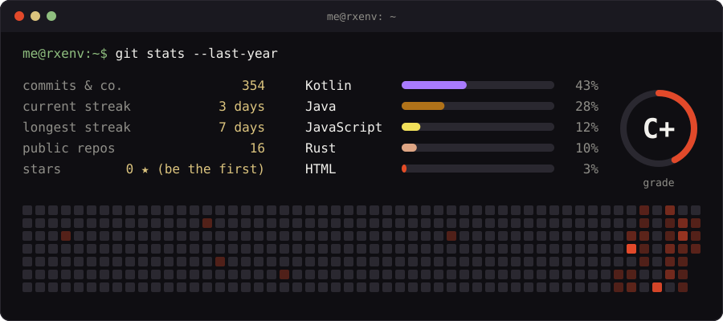

### `$ cat rexsas.toml`

```toml
[package]
name        = "rexsas"
description = "takes things apart, mostly puts them back together"
license     = "WTFPL"

[dependencies]
coffee       = "*"
docker       = { version = "latest", features = ["one-more-container"] }
gym          = { optional = false }
rabbit-holes = { git = "https://en.wikipedia.org", branch = "3am" }
sleep        = { version = "0.4", optional = true }

[dev-dependencies]
neovim = "btw"
```

### `$ git stats`



### 🐛 Open issues

| # | Title | Label |
|---|---|---|
| #1 | Has more side projects than free time |  |
| #42 | rxcord is being rewritten. Again. |  |
| #69 | Home server has better uptime than its admin |  |
| #404 | Free time not found |  |
| #500 | Opened Ghidra "just to take a quick look" |  |

### 📌 `$ tree rxenv`

[**rxenv**](https://github.com/RexSAS/rxenv) is my whole home setup in one place. Everything below lives in it:

```
rxenv/
├── RxFilms/            # Jellyfin server. runs 24/7, unlike me
├── jellyfin-plus-TV/   # RxFilms app for FireStick and LG TVs
├── rxhome-tv/          # I wrote my own TV launcher. yes, really
├── rxhome/             # phone app for the server, the TV and the lights
└── rxcord/             # Discord client in Rust, the official one ate my FPS
```

### 🧪 Also

- [**Karvo**](https://github.com/RexSAS/Karvo) + [**karvo-web**](https://github.com/RexSAS/karvo-web): ski instructors log lessons, hours and pay. Lessons stay on your phone
- [**The Oregon Thoughts**](https://github.com/RexSAS/The_Oregon_Thoughts): a CTF I made. You have died of dysentery 🐂

### `$ git log --oneline`

```diff
+ a3f9c21 (HEAD -> main) Revert "ok this one actually works"
+ 7b1e0d4 ok this one actually works
+ 51c8e9a final final
+ e04d7f2 final
+ 9c2a6b8 fix: the fix
+ 0xfe0042 fix: typo
+ 1d0c3e5 it works on my machine
- 0000000 init: hello world
```

### 🧰 Stuff I break things with


<p align="center">
  <sub>⭐ star something if it made you smile · this README has been rewritten more times than rxcord · <a href="https://rxsas.it">rxsas.it</a></sub>
  <br /><br />
  
</p>
